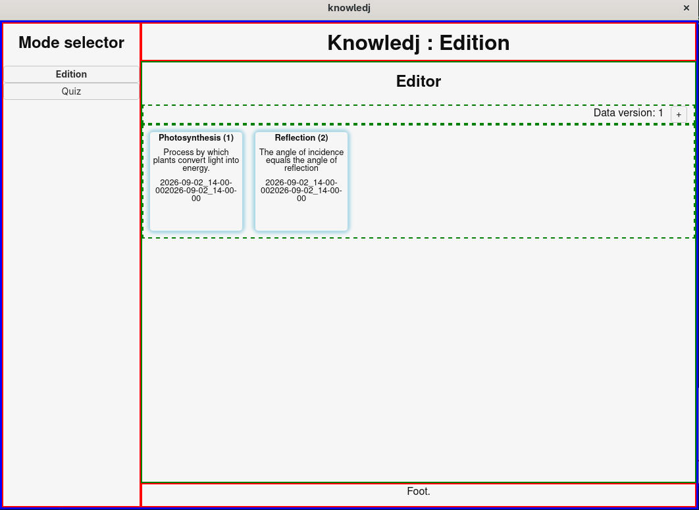

# Knowledj.

A lesson and studies storage and quiz application.


## UI.

Divided in 2 panels : 

### 1. Edition mode `v0.0.1`.


Scroll through and edit the cards.

### 2. Quiz mode `v0.0.0`.

Train thanks to randomly selected question on filtered subjects.


## Building.

In development, run : 
```sh
npm run tauri dev
```
